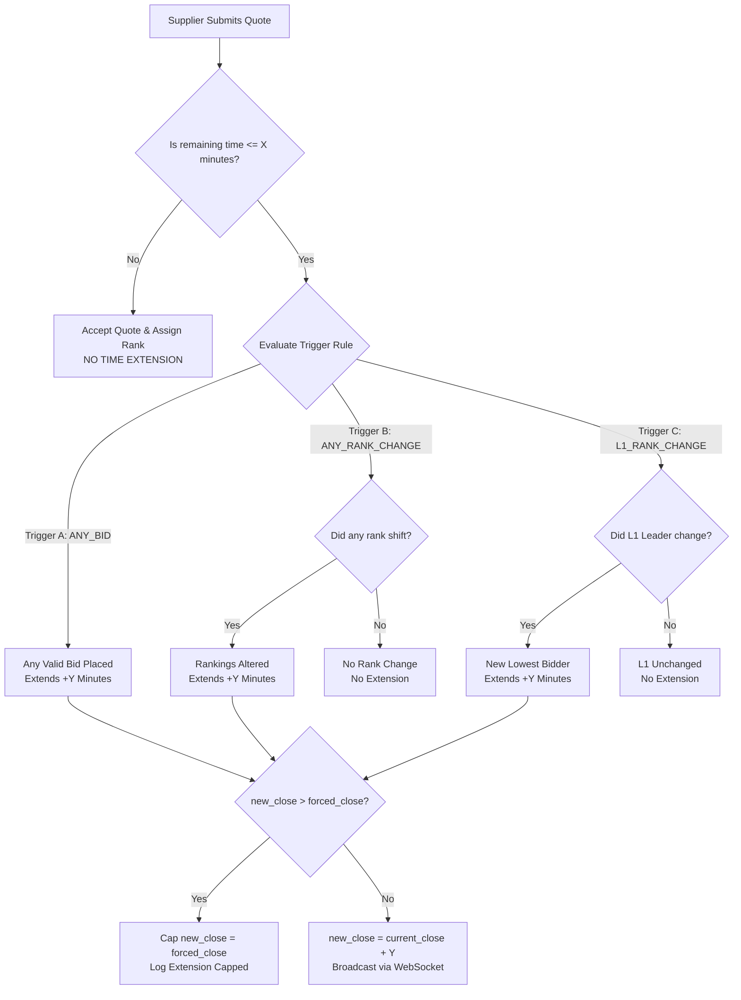
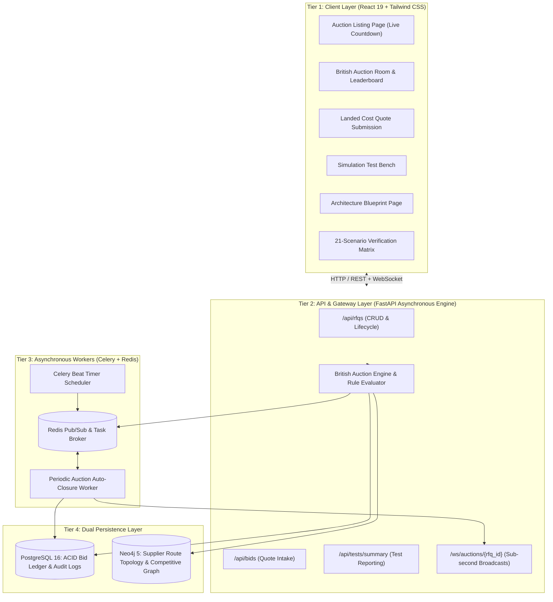
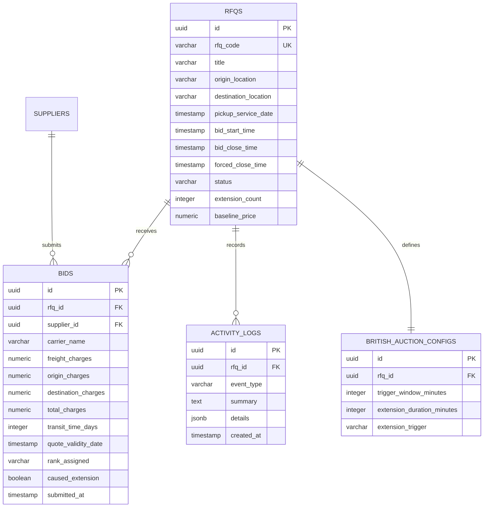

<div align="center">

# ⚡ BIDLEDGER

### Enterprise British Auction RFQ Engine with Dynamic Trigger Extensions & Forced Close Caps

[](https://bidledger-auction.onrender.com/)

[](https://fastapi.tiangolo.com)
[](https://react.dev)
[](https://tailwindcss.com)
[](https://www.postgresql.org)
[](https://neo4j.com)
[-10B981.svg?style=flat-square&logo=pytest&logoColor=white)](https://pytest.org)
[](LICENSE)

*A specialized logistics procurement engine engineered to eradicate last-second bid sniping through algorithmic trigger-window extensions bounded by hard forced-close ceilings, paired with property-graph market intelligence.*

**🌐 Production URL**: [https://bidledger-auction.onrender.com](https://bidledger-auction.onrender.com/)  
**🏛 Architecture Blueprint**: [https://bidledger-auction.onrender.com/architecture](https://bidledger-auction.onrender.com/architecture)  
**🛡 Automated Test Matrix**: [https://bidledger-auction.onrender.com/tests](https://bidledger-auction.onrender.com/tests)

</div>

---

## 📑 Table of Contents

- [1. Executive Overview & Problem Statement](#1-executive-overview--problem-statement)
- [2. The British Auction Mechanism](#2-the-british-auction-mechanism)
- [3. System Architecture & High-Level Design](#3-system-architecture--high-level-design)
- [4. Database & Graph Schema Architecture](#4-database--graph-schema-architecture)
- [5. Interactive Frontend Architecture](#5-interactive-frontend-architecture)
- [6. Verification Suite (21 Scenarios - 100% Passed)](#6-verification-suite-21-scenarios---100-passed)
- [7. Quickstart & Local Installation](#7-quickstart--local-installation)
- [8. Production Deployment Guide](#8-production-deployment-guide)

---

## 1. Executive Overview & Problem Statement

### What is an RFQ?
A **Request for Quotation (RFQ)** is a strategic B2B sourcing process where a corporate buyer requests multiple verified suppliers (logistics carriers, freight forwarders) to submit competitive, itemized price quotes for freight, origin, and destination handling.

### The Problem: Last-Second Bid Sniping
In standard fixed-time digital reverse auctions, suppliers frequently withhold their lowest possible price until the final 10–30 seconds. This **"bid sniping"**:
1. Prevents legitimate competing suppliers from responding with counter-offers.
2. Robs corporate buyers of genuine price discovery and maximum savings.
3. Distorts market competition in favor of bot-driven bidding latency advantages.

### The Solution: BidLedger
**BidLedger** combines an asynchronous British Auction mathematical engine with dual-tier data persistence:
- **Algorithmic Trigger Windows ($X$ Minutes)**: Activates real-time monitoring near auction close.
- **Dynamic Extensions ($Y$ Minutes)**: Dynamically extends the auction when competitive actions take place.
- **Tamper-Proof Hard Cap (Forced Bid Close Time)**: Enforces an absolute deadline ceiling that no extension can surpass.
- **Dual-Database Topology**: Relational PostgreSQL for strict ACID transactional ledgering alongside Neo4j graph analytics mapping supplier underbidding lineage and market competition density.

---

## 2. The British Auction Mechanism

```
                     ┌────────── Trigger Window (X min) ──────────┐
                     │                                            │
Auction Start ───────┴─────────────────────────────── Current Close ───────── Forced Close (Hard Cap)
                                                           │                        │
                                   Bid inside X min? ──────┴──> Extends by +Y min   │
                                                                                    │
                                   Extension reaches Hard Cap? ─────────────────────┴──> Hard Stop
```

### Core Configuration Parameters

| Parameter | Symbol | Mathematical Formulation | Description |
|---|:---:|---|---|
| **Trigger Window** | $X$ | $\Delta t = t_{\text{close}} - t_{\text{now}} \le X$ | Active observation window before the close where events trigger time extensions. |
| **Extension Duration** | $Y$ | $t_{\text{close}} \leftarrow \min(t_{\text{close}} + Y, t_{\text{forced}})$ | Exact time increment added upon meeting trigger criteria. |
| **Forced Close Hard Cap** | $t_{\text{forced}}$ | $\forall t, \quad t_{\text{close}} \le t_{\text{forced}}$ | Immutable ceiling time past which no further extensions are permitted under any condition. |

### Configurable Extension Triggers



---

## 3. System Architecture & High-Level Design

The system is organized into four distinct architectural tiers engineered for high concurrency, low latency, and deterministic audit trails:



---

## 4. Database & Graph Schema Architecture

### Relational Entity-Relationship Diagram (PostgreSQL)



### Graph Topology & Relationships (Neo4j Property Graph)

```
(:Supplier {name, rating}) -[:OPERATES_ON]-> (:Lane {origin, destination})
(:Supplier) -[:SUBMITTED {landed_cost, rank}]-> (:RFQ {code, status})
(:Supplier) -[:UNDERBIDS {delta_inr, timestamp}]-> (:Supplier)
```

---

## 5. Interactive Frontend Architecture

The user interface is built on a dark obsidian aesthetic inspired by high-end design systems:

```
┌─────────────────────────────────────────────────────────────────────────────────────────────┐
│  ⚡ BIDLEDGER v1.0   [Live Auctions]   [Architecture]   [Test Matrix (21/21)]   [Buyer Mode] │
├─────────────────────────────────────────────────────────────────────────────────────────────┤
│  RFQ-2026-MUM-DEL  •  Mumbai (JNPT) → Delhi NCR (ICD Tughlakabad)                           │
│  Status: [ ACTIVE ]    Current L1: ₹88,000.00    Extensions Awarded: 2 (+10 min)             │
├─────────────────────────────────────────────────┬───────────────────────────────────────────┤
│  ⏱ TIME REMAINING                               │  🏆 LIVE LEADERBOARD (4 Carriers)         │
│  00:03:42  [ TRIGGER WINDOW ACTIVE: X=10m ]     │  1. BlueDart Express   ₹88,000.00  [L1]   │
│  Close: 18:10:00  |  Forced Cap: 18:30:00       │  2. VRL Logistics      ₹91,500.00  [L2]   │
│                                                 │  3. GATI KWE           ₹94,000.00  [L3]   │
├─────────────────────────────────────────────────┼───────────────────────────────────────────┤
│  📝 QUOTE SUBMISSION CONSOLE                    │  📜 IMMUTABLE AUDIT TRAIL                 │
│  Freight: [₹75,000] Origin: [₹5,000] Dest: [₹8k]│  18:05:12 - Bid Submitted by BlueDart     │
│  Landed Cost: ₹88,000.00                        │  18:05:12 - TIME_EXTENDED: +5 min (New L1)│
│  Transit: 3 Days  |  Validity: 30 Days          │  18:00:24 - Rank Shift: VRL underbids GATI│
└─────────────────────────────────────────────────┴───────────────────────────────────────────┘
```

---

## 6. Verification Suite (21 Scenarios - 100% Passed)

A pytest suite covers every mathematical edge case, tie-breaking policy, and forced-close boundary condition:

| ID | Domain | Scenario Premise | Verified Outcome |
|:---:|---|---|---|
| **TC-01** | Triggers | Quote placed inside Trigger Window $X$ under `ANY_BID` | Auction close time automatically extends $+Y$ minutes. |
| **TC-02** | Triggers | Bid changes intermediate rank (L3 $\rightarrow$ L2) without claiming L1 | `ANY_RANK_CHANGE` fires; $+Y$ minutes extension awarded. |
| **TC-03** | Triggers | Supplier submits quote undercutting L1 leader | Leaderboard assigns L1 rank; $+Y$ extension applied. |
| **TC-04** | Triggers | Inferior bid placed in window with `L1_RANK_CHANGE` | Bid stored; **zero extension** awarded (prevents spam). |
| **TC-05** | Triggers | Quote placed outside Trigger Window ($\Delta t > X$) | Quote accepted; **no extension** awarded outside window. |
| **TC-06** | Forced Close | Extension would exceed `forced_close_time` ceiling | Extension strictly capped at `forced_close_time`. |
| **TC-07** | Forced Close | Subsequent bids placed when already at forced close | Quotes accepted; further extensions blocked. |
| **TC-08** | Validation | Attempt to create RFQ with `forced_close <= bid_close` | Rejected with Pydantic validation error. |
| **TC-09** | Validation | Attempt to create RFQ with `bid_close <= bid_start` | Rejected with Pydantic validation error. |
| **TC-10** | Pricing | Two suppliers submit exact same landed price | Earlier timestamp wins L1 tie-breaker. |
| **TC-11** | Pricing | Itemized freight + origin + destination calculation | Correctly sums itemized charges into total landed cost. |
| **TC-12** | Lifecycle | Bid submission after `bid_close_time` elapsed | Rejected: `Auction is already closed`. |
| **TC-13** | Lifecycle | Bid submission after `forced_close_time` elapsed | Rejected: `Auction is force-closed`. |
| **TC-14** | API | GET `/api/health` service probe | Returns HTTP 200 OK with operational health metadata. |
| **TC-15** | API | GET `/api/rfqs` catalog retrieval | Returns all active RFQs with itemized countdowns. |
| **TC-16** | End-to-End | Complete multi-carrier dynamic bidding flow | Full lifecycle: Create $\rightarrow$ Bidding $\rightarrow$ Extension $\rightarrow$ Close. |
| **TC-17** | Simulation | Fast-Forward clock to Trigger Window | Clocks align to 3 minutes before close. |
| **TC-18** | Simulation | Simulate instant L1 takeover underbid | Injects competitive quote and verifies dynamic extension. |
| **TC-19** | Simulation | Simulate Forced Close boundary condition | Validates hard cap stopping behavior. |
| **TC-20** | Graph | GET `/api/rfqs/{id}/analytics` graph intelligence | Returns Neo4j node-edge topology and buyer savings. |
| **TC-21** | Lifecycle | State transitions: `upcoming` $\rightarrow$ `active` $\rightarrow$ `closed` | Validates time-based lifecycle state machine. |

---

## 7. Quickstart & Local Installation

### Prerequisites
- Python 3.9+
- Node.js 18+ (for frontend source development)

### One-Command Quick Launch
```powershell
# Clone the repository
git clone https://github.com/KaranJoshi03/BIDLEDGER.git
cd BIDLEDGER

# Install backend dependencies
cd backend
pip install -r requirements.txt

# Start the complete full-stack platform (FastAPI + Embedded React SPA)
python run.py
```

The application will start immediately on **`http://localhost:8000`** with pre-seeded demo auctions, carriers, and historical bids.

### Running with Docker Compose
```bash
docker-compose up --build
```
This spins up PostgreSQL, Neo4j, Redis, Celery, and the FastAPI backend service automatically.

### Running the Test Suite
```powershell
cd backend
pytest tests/ -v
```


<div align="center">

**Built with precision for enterprise logistics procurement.**

[Report an Issue](https://github.com/KaranJoshi03/BIDLEDGER/issues) • [Request a Feature](https://github.com/KaranJoshi03/BIDLEDGER/pulls)

</div>
