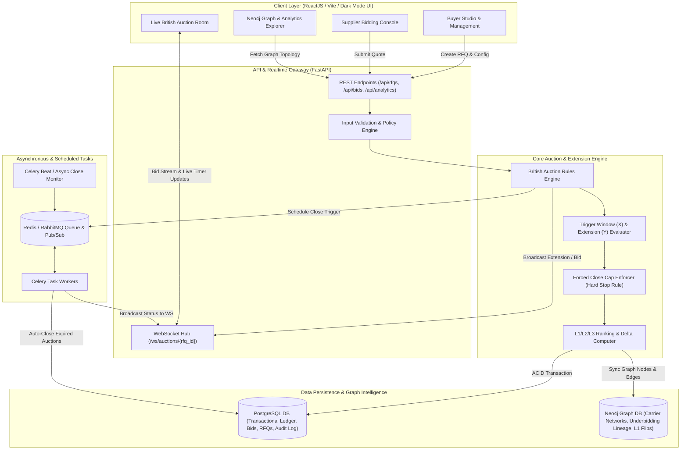
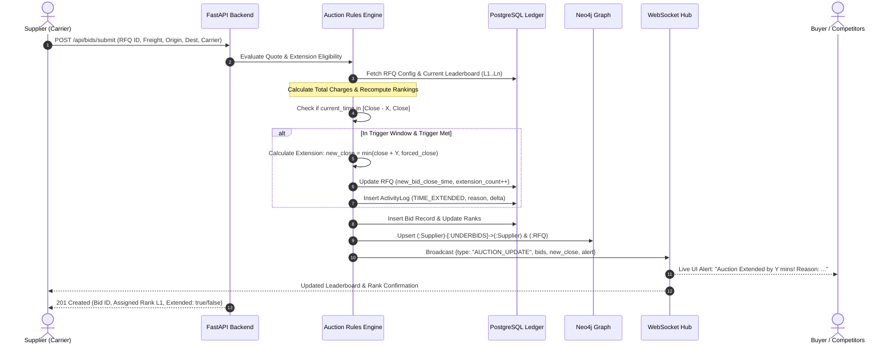

# BidLedger: High-Level Design (HLD)

## 1. System Overview
**BidLedger** is an enterprise-grade Request for Quotation (RFQ) platform engineered specifically for **British Auction-style dynamic bidding**. In traditional procurement auctions, suppliers frequently engage in "bid sniping"—submitting artificially low bids in the final seconds before auction close, denying competitors fair response time and denying buyers optimal price discovery.

BidLedger solves this through configurable algorithmic auction extensions bounded by a strict, tamper-proof **Forced Close Time**, paired with a dual-database architecture: **PostgreSQL** for ACID-compliant transactional bid ledgering and **Neo4j** for real-time competitive graph analytics (underbidding networks, supplier clusters, and L1 dominance transitions).

---

## 2. Architecture Diagram

---

## 3. Core Architectural Components

### 3.1 Frontend (ReactJS + Tailwind CSS + Dark Mode)
- **Design Philosophy**: Minimalist, dark-mode architectural styling inspired by high-end design systems (deep obsidian backgrounds `#09090b`, `#121217`, subtle borders `#27272a`, high-contrast typography, emerald for active/saving metrics, amber for warning/extension zones, and rose for hard forced close).
- **Live Auction Room**: Sub-second synchronized countdown, dynamic pulse when inside the **Trigger Window (X)**, animated extension notifications, live L1/L2/L3 leaderboard, split quote breakdown (Freight + Origin + Destination charges), and immutable audit activity timeline.
- **Interactive Simulation Bench**: Built-in test harness enabling buyers and evaluators to fast-forward the auction clock, simulate rival bids during the final 2 minutes, and test all three extension triggers without waiting hours.

### 3.2 Backend Service (FastAPI)
- **High Concurrency Async API**: Fully asynchronous request handling for quote submission and query endpoints.
- **WebSocket Broadcast Engine**: In-memory connection manager and Redis Pub/Sub integration broadcasting bid placements, ranking recalculations, and time extension events to all connected buyers and suppliers.
- **Dual-Mode Persistence Layer**: Runs natively against PostgreSQL in production, with seamless zero-dependency local SQLite support for instant local demonstrations.

### 3.3 British Auction Rules Engine
When a quote is submitted:
1. **Window Validation**: Checks that `bid_start_time <= now < bid_close_time` and `now < forced_close_time`.
2. **Quote Total**: Sums `freight_charges + origin_charges + destination_charges`.
3. **Rank Snapshot**: Captures supplier rankings prior to bid execution.
4. **Rank Recalculation**: Sorts all active bids in ascending order of total cost (earlier timestamp breaks ties).
5. **Trigger Window (X Minutes) Check**:
   $$\Delta t = \text{bid\_close\_time} - \text{now}$$
   Evaluates if $0 \le \Delta t \le X\text{ minutes}$.
6. **Trigger Condition Evaluation**:
   - **Trigger A (Any Bid)**: Any valid bid placed within $X$ minutes fires an extension.
   - **Trigger B (Any Rank Change)**: Fires if any supplier's position in the leaderboard changed.
   - **Trigger C (Lowest Bidder / L1 Rank Change)**: Fires strictly if the L1 leader position changes.
7. **Forced Close Hard Cap Enforcement**:
   $$\text{new\_close\_time} = \min(\text{current\_close\_time} + Y, \text{forced\_close\_time})$$
   The auction **never** extends past `forced_close_time`. If the extension would exceed the forced close time, it is capped exactly at the forced close time. If already at forced close time, the extension is rejected and marked as capped.

### 3.4 Asynchronous Worker & Scheduler (Celery + Redis)
- **Dynamic Auction Close Task**: Periodically verifies closing criteria and transitions auctions from `active` to `closed` or `force_closed`.
- **Scheduled Timers**: Celery tasks triggered at `bid_close_time` and `forced_close_time` to seal bids and declare winning L1 suppliers.

### 3.5 Graph Intelligence Engine (Neo4j)
- BidLedger models the procurement network as a property graph:
  - `(s:Supplier)-[:SUBMITTED_BID]->(r:RFQ)`
  - `(s1:Supplier)-[:UNDERBIDS {delta_amount, timestamp}]->(s2:Supplier)`
  - `(s:Supplier)-[:OVERTOOK_L1]->(r:RFQ)`
  - `(s:Supplier)-[:OPERATES_CARRIER]->(c:Carrier)`
- Graph algorithms analyze supplier competition density, detect cartel/collusion patterns, and compute supplier win-ratios across freight lanes.

---

## 4. Sequence Diagram: Quote Submission & British Extension Flow

