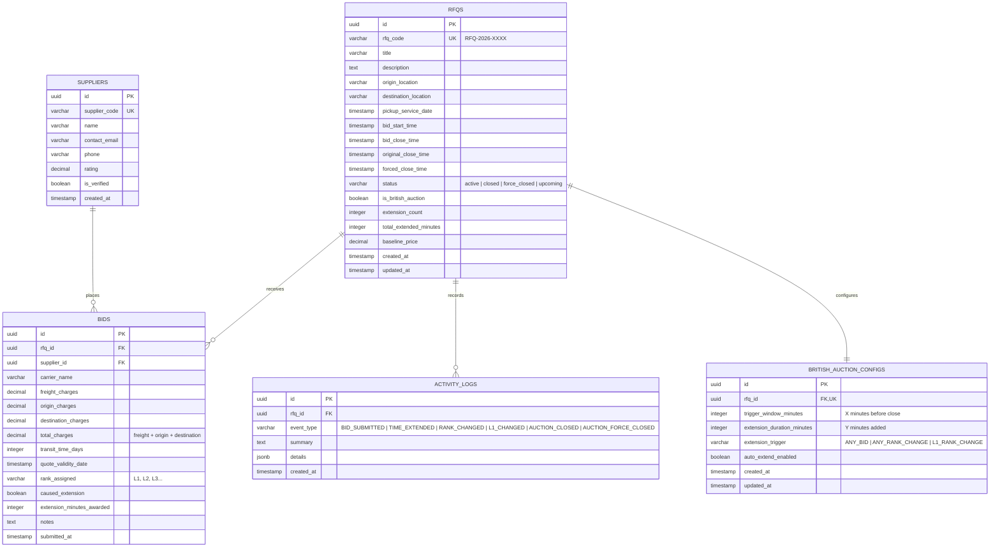
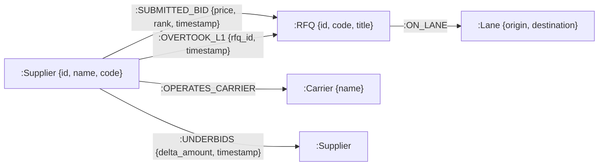

# BidLedger: Database Schema Design

This document details the relational data model for **PostgreSQL** and the graph data model for **Neo4j**.

---

## 1. PostgreSQL Relational Schema

### 1.1 Entity Relationship Diagram (ERD)



---

### 1.2 PostgreSQL DDL (SQL Script)

```sql
-- Create Enum Types
CREATE TYPE rfq_status_enum AS ENUM ('upcoming', 'active', 'closed', 'force_closed');
CREATE TYPE extension_trigger_enum AS ENUM ('ANY_BID', 'ANY_RANK_CHANGE', 'L1_RANK_CHANGE');
CREATE TYPE log_event_type_enum AS ENUM ('BID_SUBMITTED', 'TIME_EXTENDED', 'RANK_CHANGED', 'L1_CHANGED', 'AUCTION_CLOSED', 'AUCTION_FORCE_CLOSED');

-- 1. Suppliers Table
CREATE TABLE suppliers (
    id UUID PRIMARY KEY DEFAULT gen_random_uuid(),
    supplier_code VARCHAR(50) UNIQUE NOT NULL,
    name VARCHAR(255) NOT NULL,
    contact_email VARCHAR(255) NOT NULL,
    phone VARCHAR(50),
    rating NUMERIC(3, 2) DEFAULT 5.00 CHECK (rating >= 1.00 AND rating <= 5.00),
    is_verified BOOLEAN DEFAULT true,
    created_at TIMESTAMPTZ DEFAULT CURRENT_TIMESTAMP
);

-- 2. RFQs Table
CREATE TABLE rfqs (
    id UUID PRIMARY KEY DEFAULT gen_random_uuid(),
    rfq_code VARCHAR(50) UNIQUE NOT NULL,
    title VARCHAR(255) NOT NULL,
    description TEXT,
    origin_location VARCHAR(255) NOT NULL,
    destination_location VARCHAR(255) NOT NULL,
    pickup_service_date TIMESTAMPTZ NOT NULL,
    bid_start_time TIMESTAMPTZ NOT NULL,
    bid_close_time TIMESTAMPTZ NOT NULL,
    original_close_time TIMESTAMPTZ NOT NULL,
    forced_close_time TIMESTAMPTZ NOT NULL,
    status rfq_status_enum NOT NULL DEFAULT 'upcoming',
    is_british_auction BOOLEAN NOT NULL DEFAULT true,
    extension_count INT NOT NULL DEFAULT 0,
    total_extended_minutes INT NOT NULL DEFAULT 0,
    baseline_price NUMERIC(14, 2),
    created_at TIMESTAMPTZ DEFAULT CURRENT_TIMESTAMP,
    updated_at TIMESTAMPTZ DEFAULT CURRENT_TIMESTAMP,

    -- Business Rule Constraints
    CONSTRAINT chk_rfq_start_before_close CHECK (bid_start_time < bid_close_time),
    CONSTRAINT chk_rfq_close_before_forced CHECK (bid_close_time <= forced_close_time),
    CONSTRAINT chk_rfq_forced_greater_than_close CHECK (forced_close_time > original_close_time)
);

-- 3. British Auction Configurations
CREATE TABLE british_auction_configs (
    id UUID PRIMARY KEY DEFAULT gen_random_uuid(),
    rfq_id UUID UNIQUE NOT NULL REFERENCES rfqs(id) ON DELETE CASCADE,
    trigger_window_minutes INT NOT NULL CHECK (trigger_window_minutes > 0),
    extension_duration_minutes INT NOT NULL CHECK (extension_duration_minutes > 0),
    extension_trigger extension_trigger_enum NOT NULL DEFAULT 'L1_RANK_CHANGE',
    auto_extend_enabled BOOLEAN NOT NULL DEFAULT true,
    created_at TIMESTAMPTZ DEFAULT CURRENT_TIMESTAMP,
    updated_at TIMESTAMPTZ DEFAULT CURRENT_TIMESTAMP
);

-- 4. Bids (Quotes) Table
CREATE TABLE bids (
    id UUID PRIMARY KEY DEFAULT gen_random_uuid(),
    rfq_id UUID NOT NULL REFERENCES rfqs(id) ON DELETE CASCADE,
    supplier_id UUID NOT NULL REFERENCES suppliers(id) ON DELETE RESTRICT,
    carrier_name VARCHAR(255) NOT NULL,
    freight_charges NUMERIC(14, 2) NOT NULL CHECK (freight_charges >= 0),
    origin_charges NUMERIC(14, 2) NOT NULL DEFAULT 0.00 CHECK (origin_charges >= 0),
    destination_charges NUMERIC(14, 2) NOT NULL DEFAULT 0.00 CHECK (destination_charges >= 0),
    total_charges NUMERIC(14, 2) GENERATED ALWAYS AS (freight_charges + origin_charges + destination_charges) STORED,
    transit_time_days INT NOT NULL CHECK (transit_time_days > 0),
    quote_validity_date TIMESTAMPTZ NOT NULL,
    rank_assigned VARCHAR(10),
    caused_extension BOOLEAN NOT NULL DEFAULT false,
    extension_minutes_awarded INT NOT NULL DEFAULT 0,
    notes TEXT,
    submitted_at TIMESTAMPTZ DEFAULT CURRENT_TIMESTAMP
);

-- 5. Activity Logs Table (Audit Trail)
CREATE TABLE activity_logs (
    id UUID PRIMARY KEY DEFAULT gen_random_uuid(),
    rfq_id UUID NOT NULL REFERENCES rfqs(id) ON DELETE CASCADE,
    event_type log_event_type_enum NOT NULL,
    summary VARCHAR(500) NOT NULL,
    details JSONB NOT NULL DEFAULT '{}'::jsonb,
    created_at TIMESTAMPTZ DEFAULT CURRENT_TIMESTAMP
);

-- Indexes for high-frequency queries
CREATE INDEX idx_rfqs_status ON rfqs(status);
CREATE INDEX idx_rfqs_bid_close ON rfqs(bid_close_time);
CREATE INDEX idx_bids_rfq_total ON bids(rfq_id, total_charges ASC, submitted_at ASC);
CREATE INDEX idx_bids_supplier ON bids(supplier_id);
CREATE INDEX idx_activity_logs_rfq ON activity_logs(rfq_id, created_at DESC);
```

---

## 2. Neo4j Graph Data Model

### 2.1 Graph Schema Overview
In Neo4j, BidLedger tracks bidding behavior, supplier competition graphs, and logistics relationships:



### 2.2 Cypher DDL & Constraints

```cypher
// 1. Constraints
CREATE CONSTRAINT unique_supplier_id FOR (s:Supplier) REQUIRE s.id IS UNIQUE;
CREATE CONSTRAINT unique_rfq_id FOR (r:RFQ) REQUIRE r.id IS UNIQUE;
CREATE CONSTRAINT unique_carrier_name FOR (c:Carrier) REQUIRE c.name IS UNIQUE;
CREATE CONSTRAINT unique_lane_key FOR (l:Lane) REQUIRE l.key IS UNIQUE;

// 2. Sample Relationship Ingestion
// Supplier submits bid:
MATCH (s:Supplier {id: $supplier_id}), (r:RFQ {id: $rfq_id})
CREATE (s)-[b:SUBMITTED_BID {
    bid_id: $bid_id,
    total_charges: $total_charges,
    freight: $freight,
    carrier: $carrier,
    rank: $rank,
    timestamp: datetime()
}]->(r);

// Supplier underbids rival:
MATCH (new_s:Supplier {id: $new_supplier_id}), (prev_s:Supplier {id: $prev_supplier_id})
CREATE (new_s)-[:UNDERBIDS {
    rfq_id: $rfq_id,
    delta: $delta,
    timestamp: datetime()
}]->(prev_s);

// Supplier becomes new L1 (Lowest Bidder):
MATCH (s:Supplier {id: $supplier_id}), (r:RFQ {id: $rfq_id})
CREATE (s)-[:OVERTOOK_L1 {
    bid_id: $bid_id,
    price: $total_charges,
    timestamp: datetime()
}]->(r);
```
